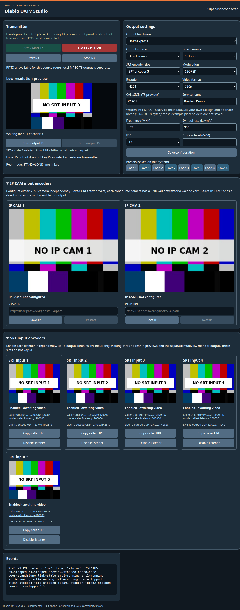
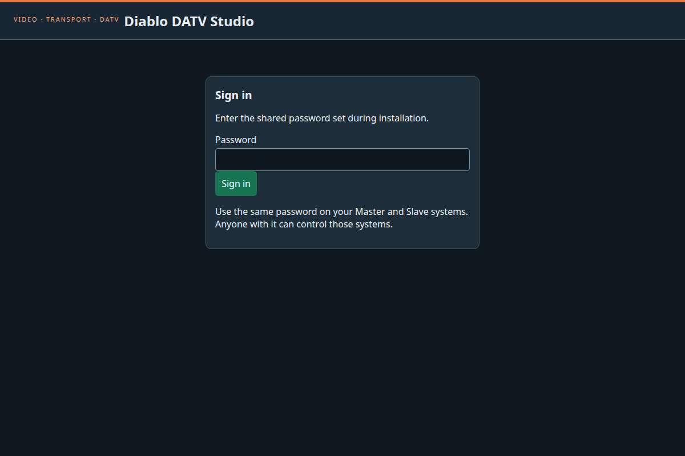
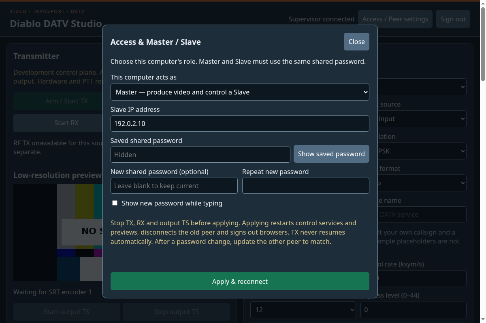
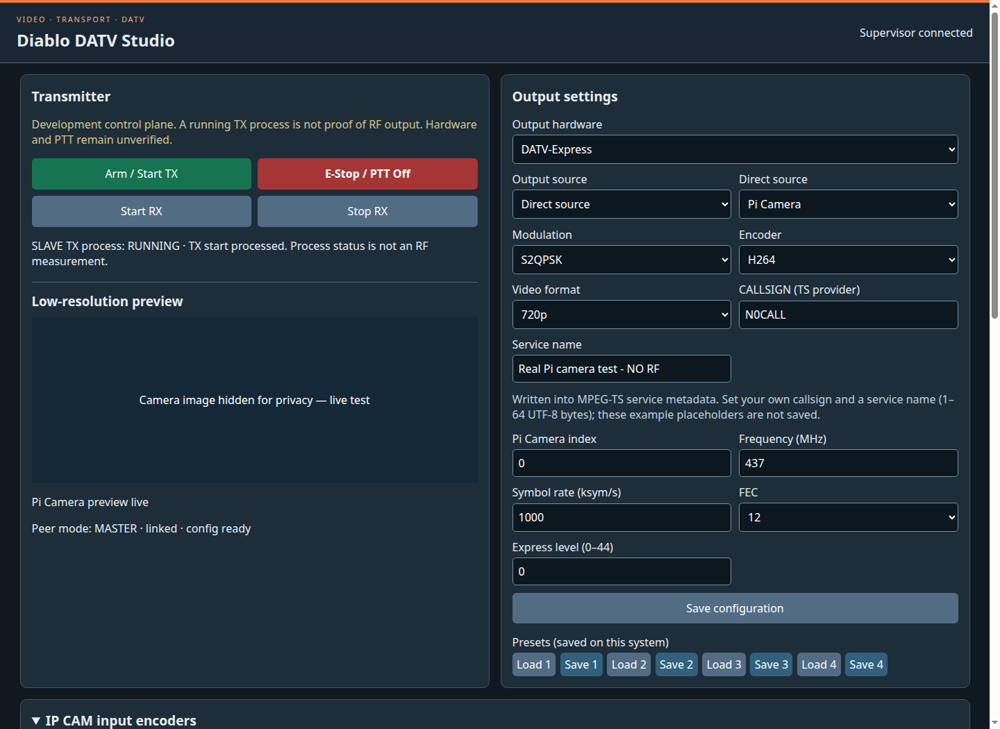
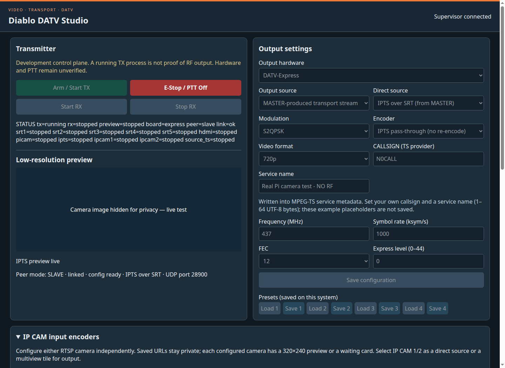

# Diablo DATV Studio

**Headless video sources, MPEG transport streams, and experimental DATV control.**
A Linux-native web interface built with a persistent **ucode** daemon, a small C
process supervisor, and vanilla HTML/CSS/JavaScript. No physical touchscreen,
framebuffer, Node.js server, or Python server is required for the new GUI.



[Start here: your first picture](doc/FIRST_START.md) · [Install / update](doc/INSTALL.md) · [Screenshot gallery](doc/SCREENSHOTS.md) ·
[Development & tests](doc/DEVELOPMENT.md) · [Status / open issues](doc/KNOWN_ISSUES.md) ·
[Migration record](doc/MIGRATION.md) · [Documentation index](doc/README.md)

## What is here

- **Five SRT input encoders**, each with a listener, live-only MPEG-TS output,
  320×240 preview, and a waiting card when video is absent. Tested input modes
  include **480p25, 720p24, and 1080p15**.
- **Two RTSP IP CAM inputs**, each with Save IP / Restart controls and a preview.
  Private camera URLs are kept out of presets, API responses, and screenshots.
- **HDMI/V4L2, Pi Camera and UDP IPTS previews**, direct source selection, and a
  **four-tile multiview** with an independent source selector per quadrant.
- **Local MPEG-TS output** from a selected SRT encoder, an IP camera, or the
  low-rate multiview. CALLSIGN and service-name metadata are operator supplied.
- **DekTec DTA-2145 ASI file/live-IP launchers**, driver/environment scripts,
  metadata correction where available, and a non-blocking metadata mismatch flag.
- Presets, live status/log events, Master/Slave control and heartbeat shutdown.
- The inherited **32-bit Trixie migration**, **64-bit transmitter**, DATV-Express
  DVB-S and experimental **DVB-S2 QPSK** code, and legacy Pluto/Lime/Streamer code.

**Development release, not a hardware-qualified transmitter.** The headless
installer deliberately leaves RF/ASI TX unarmed. Software TS/preview tests are
not proof of RF or physical ASI output. There is **no DVB-S2X backend** in this
repository. The retained legacy RF paths are not all connected to the new GUI.
See the [capability and acceptance matrix](doc/KNOWN_ISSUES.md).

## Can I install it and try it?

**Yes—for the web interface, previews and software video paths.** Start with a
64-bit Linux Pi or PC. No camera, OBS or transmitter board is needed for the
included 30-second moving-picture test. Radio transmission and ASI setup are
separate advanced tasks, not enabled by the basic installer.

**New to Linux? Follow [First start: get your first picture](doc/FIRST_START.md).**
It explains where to type commands, what to answer in setup, how to open the
browser, and what a successful test looks like. Windows/macOS can be used as
browser clients; the program itself runs on Linux.

Already comfortable with Linux? On a supported Linux computer:

```sh
cd "$HOME" &&
sudo apt-get update &&
sudo apt-get install -y git &&
git clone --branch Trixie https://github.com/mathisono/Diablo-DATV-Studio.git &&
cd Diablo-DATV-Studio &&
bash scripts/first-start.sh
```

The first test uses SRT input 1 automatically. Enter your own callsign. Choose
either **Pi-only browser access** without a web password, or **access from another
computer** with a web admin password. For LAN access, open the printed HTTPS
address, check the first-visit certificate fingerprint and sign in—**no SSH
tunnel**. Paired Master and Slave systems use the same password. Click
**Access / Peer settings** to view/change it, select a role, and enter the Slave
address. [Web pairing, step by step](doc/LAN_ACCESS.md#pair-a-master-and-slave).
Leave Diablo's terminal running. In a second terminal on that same
Linux computer, run `bash "$HOME/Diablo-DATV-Studio/scripts/test-srt-input.sh"`.
Watch for live video, then the waiting card when the 30-second sender finishes.
Stop Diablo with **Ctrl+C**. Keep the downloaded folder in place.





Already installed? Use the [short update and backup steps](doc/INSTALL.md#update-an-existing-install),
not a second clone. [Advanced setup reference](doc/INSTALL_REFERENCE.md).

The old `install_portsdown.sh`, `update.sh`, and menu updater are intentionally
blocked in this repo: they target the old Buster/Portsdown distribution. They
must not replace Diablo with an upstream `master` checkout.

## Hardware and validation

| Target | Evidence | Remaining |
| --- | --- | --- |
| x86-64 development host | C/ucode tests, FFmpeg TS, SRT and browser fixtures | Not a physical capture or RF test |
| TANK, Pi 4 / AArch64 Trixie | Fresh user-local native bootstrap; actual IMX708 720p24 camera → SRT → VideoLP3D, preview/loss/recovery and peer mock-TX tests | Not a freshly imaged OS acceptance; no DATV-Express RF test |
| LattePanda 3 Delta, Mint 22.3 | DTA-2145 finite file and TANK SRT-to-card playout, stop/reopen; TS analysis; QSV CQP encode | BNC disconnected: downstream ASI signal/timing, full GUI source routing and endurance pending |
| Raspberry Pi OS Trixie armhf | Ported source retained | Fresh 32-bit full-system/capture/display/RF acceptance |

See [ASI card test results and commands](doc/asi-output.md) for the verified
subset and remaining limits.

The **ASI card transports MPEG-TS to an external modulator**; it does not itself
supply DVB-S/S2 frequency, symbol rate, or FEC. QSV CQP encoding works on the tested
Jasper Lake GPU but cannot guarantee a fixed bitrate; libx264 remains the
fixed-rate fallback. See [the measured hardware notes](doc/lattepanda-dta-driver.md).

## Real camera and two-host test

**TANK Pi Camera → SRT → VideoLP3D**, tested 2026-11-25 with actual 720p24
H.264 video and a synthetic AAC test tone. Standalone SRT arrival, waiting-card
fallback and reconnection passed. In peer mode, MASTER retained Pi Camera while
SLAVE accepted only IPTS over SRT. These are real web-GUI captures; private camera
scenes are explicitly masked, not replaced with synthetic video.

### TANK MASTER — camera live, remote mock TX running



### VideoLP3D SLAVE — received IPTS live, settings locked



**TX here is a mock process: no RF or ASI output.** Media helpers ran separately
from the TX lifecycle; complete GUI source-to-output routing and media-loss
interlocking remain open. Local SLAVE E-Stop reached MASTER; heartbeat loss
stopped mock TX in 1.298 s, disconnect in 0.029 s, without automatic restart.

[Standalone live, no-signal and E-Stop screenshots](doc/SCREENSHOTS.md#real-pi-camera-to-srt-and-peer-control) ·
[Test method, results and limitations](doc/testing/picam-srt-two-host-2026-11-25.md)

## Project lineage and licensing

This repo consolidates `mathisono/portsdown4_NTSC` development without dropping
its commit history. `headless-ucode-control` at `a9106a9` already contains
`arm64-transmitter` at `f0047f7` and `Trixie` at `7f1d1c3`.

Built on work from **BATC / Portsdown, KG6MDW, F5OEO, G4GUO**, and other
contributors. Existing copyright/license notices and hardware test history are
retained. See [CREDITS.md](CREDITS.md) and [LICENSE](LICENSE). Diablo is a separate
experimental project, not a BATC-endorsed release.
