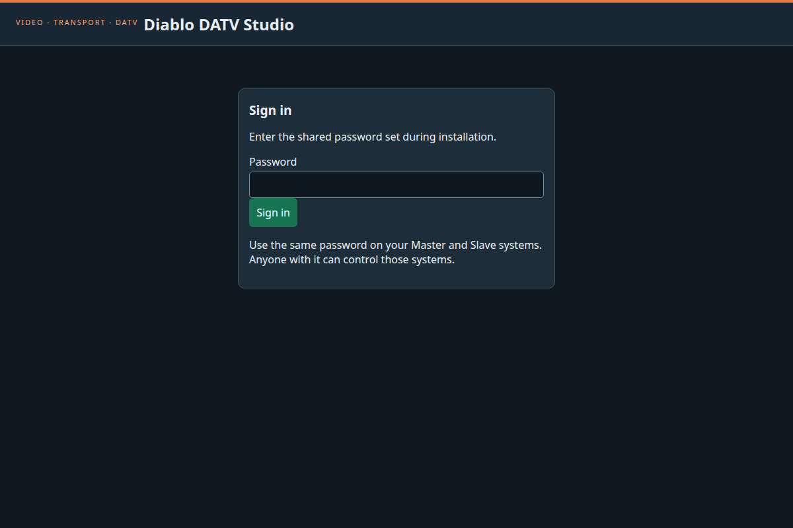
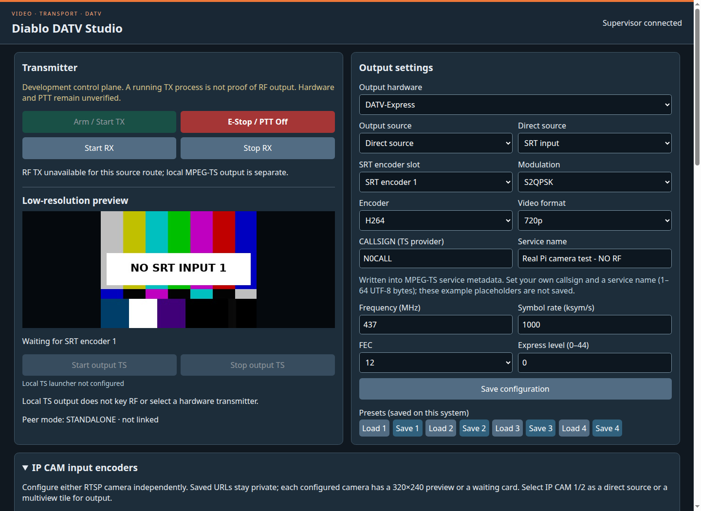

# First start — get your first picture

Install Diablo on a Raspberry Pi, open its web page, and check a moving test
picture. You do **not** need a transmitter board, camera or OBS for this first test.

This is a **development release**. The basic install does not enable radio
transmission or ASI output. Those require separate hardware setup and testing.

## 1. What you need

- A **Raspberry Pi 4** with **64-bit Raspberry Pi OS Trixie**. Choose **Desktop**
  if you want to use a screen and Chromium on the Pi; choose **Lite** if you will
  use SSH and open Diablo from another computer. A Pi 4 with 4 GB RAM is a good
  starting point. This is a development release, so report any Pi OS or device
  combinations that do not work as described.
- A **16 GB or larger U1/Class 10 microSD card**. A 32 GB high-endurance card is
  recommended, especially if you will record video. Keep your working station's
  SD card aside while trying this development version.
- An Internet connection and your normal Pi login with permission to install
  software. Do not log in as `root`.
- A web browser: **Chromium on the Pi Desktop**, or a browser on a Mac or PC on
  the same network. Lite has no desktop browser.

**Find the Pi's network address:** on the Pi, open Terminal and type `hostname -I`.
Use the first address on your home network. If the Pi has no screen, look for it
in your router's device list. The address may also appear on the Pi's login or
desktop screen, depending on the OS image. You will need it to connect by SSH
or open Diablo from another computer.

**Installing over SSH?** Enable SSH and set your Pi username/password in
Raspberry Pi Imager before first boot. From a Mac Terminal or Windows PowerShell,
connect with `ssh YOUR_USER@YOUR_PI_IP` using the address you found above.
The remaining commands run **on the Pi**, in that SSH window.

## 2. Install

Open **Terminal on the Pi**, or use the SSH window connected to the Pi. Copy this
entire block, paste it, then press Enter:

```sh
cd "$HOME" &&
sudo apt-get update &&
sudo apt-get install -y git &&
git clone --branch Trixie https://github.com/mathisono/Diablo-DATV-Studio.git &&
cd Diablo-DATV-Studio &&
bash scripts/first-start.sh
```

When **sudo** asks for a password, use your **Pi login password**. Diablo updates
the Pi's installed packages before its first build and does not reboot it.
Package updates and building can take a while; keep the terminal open.
When Diablo later asks about browser access, you can choose **Pi-only access
without a web password**, or **access from another computer** with a separate
web admin password. Nothing appears on screen while you type a password.

**Already have a `Diablo-DATV-Studio` folder?** Do not delete it or clone over it.
Use [Install / update](INSTALL.md#update-an-existing-install) instead.
If a command fails, stop and use [Help](#if-something-does-not-work) below.

## 3. Answer the setup questions

The first video input is automatically set to the **SRT test picture**. You can
choose a camera or other input in the web page later. The wizard no longer asks
for internal port numbers or capture-device permissions during basic setup.

| Setup question | What to enter |
| --- | --- |
| Your amateur-radio callsign | Enter your own callsign. `N0CALL` is not accepted. Diablo uses your callsign as the initial stream service name. |
| Open Diablo from another computer on your network? | **yes** for a Mac, PC or another browser on your LAN. **no** if you will use only Chromium on this Pi. |
| Web admin password / Repeat web admin password | Asked only for LAN browser access. Use at least 8 characters; longer is better. A short, blank or mismatched entry can be corrected without restarting setup. |
| Start GUI now in foreground? | Type `yes` |

Anyone on your LAN who knows the web admin password can control Diablo. If you
later pair Master and Slave stations, they must use the same password. Pi-only
access needs no password, but its page is reachable **only from that Pi**, not
from your Mac or another computer.

**Success looks like:** `GUI startup/API/shutdown check passed`, followed by a
browser address. The last answer starts Diablo and keeps it running in this
terminal. Leave that terminal open. No service is started automatically at boot.

## 4. Open the web page

Open the **Browser:** address printed by setup. For LAN access it looks like
**`https://192.168.3.33:8443/`**; use your Pi's actual address. For Pi-only
access, open **`http://127.0.0.1:8080/` in Chromium on the Pi**. A browser on
another computer cannot use the Pi-only address. No SSH tunnel is needed.

For LAN access, the first browser visit warns that the certificate is self-signed.
Open the certificate details and compare its **SHA-256 fingerprint** with the
one printed by setup. If they match, trust that certificate for this host and
continue. Do not continue if they differ. The warning is about the locally
issued certificate; the connection is still encrypted.



For LAN access, enter the **web admin password** you chose during setup and click
**Sign in**. Your Pi login password is not used here. Each browser signs in
again after eight hours or when Diablo restarts. Pi-only access has no sign-in.
**Sign out** closes a LAN browser's session and previews; it does not stop an
active transmitter.

You should see **Diablo DATV Studio**, source **SRT input**, slot **1**, and a
waiting picture. **Do not press Arm / Start TX** to see video.

## 5. Show a test picture — no extra hardware

Open another terminal **on the Pi**. If using SSH, open a second SSH login to
the Pi. Leave Diablo running. Copy and run:

```sh
cd "$HOME/Diablo-DATV-Studio" &&
bash scripts/test-srt-input.sh
```

Watch the **Low-resolution preview** in the web page:

1. Within several seconds, a moving test picture should replace the waiting card.
2. The sender runs for **30 seconds**, then stops by itself.
3. Within several seconds of stopping, **NO SRT INPUT 1** should return.
4. Run the command again: live video should return.

If it stays on the waiting card, expand **SRT input encoders** and check input 1
is enabled. Disconnect any other sender using input 1. Under **Output settings**,
select **Video layout → One video input**, **Video input → SRT input**, then
**SRT encoder slot → 1**. Click **Save configuration** if needed.

**A successful picture → waiting → picture test means your basic installation
and local SRT preview work.** It does not prove a remote network connection,
RF transmission or ASI output. The preview is video-only; the test sends an
audio tone but you will not hear it in this preview.



This screenshot is from a hardware test installation; some output settings differ
from your fresh setup. The waiting image and SRT slot behavior are what to check.

## 6. Stop and start again

To stop Diablo, click its original terminal and press **Ctrl+C**. To start Diablo
another day, run this **on the Pi**, then open the browser address printed by setup:

```sh
"$HOME/.local/share/diablo-datv-studio/bin/diablo-studio"
```

Your settings are saved. Keep the `Diablo-DATV-Studio` folder in place; the
installed launcher still uses it.

## Next: your own video

Start with **one** source, after the test above works:

- **OBS / another SRT sender:** use input 1's caller link in **SRT input encoders**.
  The sender must support **SRT with MPEG-TS**, not RTMP. The link needs the Pi's
  LAN address, not `127.0.0.1`. Allow UDP 9101 from your sender if a
  firewall blocks it. The browser connection does not carry the SRT video stream.
- **USB HDMI capture:** follow the [USB capture guide](usb-hdmi-capture.md).
- **RTSP camera:** use **IP CAM input encoders → Save IP**, then **Restart**;
  select that camera under **Video input**. Keep its password private.
- **Pi Camera, software TS output, permissions or scripted setup:** see the
  [advanced setup reference](INSTALL_REFERENCE.md).
- **Master/Slave and password changes:** click **Access / Peer settings** in the web GUI. Follow the [web pairing instructions](LAN_ACCESS.md#pair-a-master-and-slave), then consult [peer operation](peer-control.md).
- **ASI or a radio transmitter:** read the [current limitations](KNOWN_ISSUES.md)
  and [ASI guide](asi-output.md) first. These are separate from first start.

## If something does not work

| What you see | What to do |
| --- | --- |
| Install reports an error | Stop there. Copy the last error lines, not pages of scrolling output |
| “Already running” | Return to the original Diablo terminal and press Ctrl+C; do not delete lock files |
| “Address already in use” | Stop Diablo and check that no other program uses the printed port; ask for help before changing an internal port |
| Browser cannot connect | Check Diablo is still running and use its printed address. For Pi-only access, open Chromium **on the Pi**, not another computer. For LAN access, allow TCP 8443 through the Pi firewall if needed |
| Forgot the web admin password | Stop Diablo and run `bash scripts/setup-access.sh` from its source folder; set the same new password on both peers |
| Certificate warning changed | Check the current fingerprint using [LAN access help](LAN_ACCESS.md); do not blindly bypass it |
| Test sender reports a connection error | Enable SRT input 1 and run the sender on the Pi, not your browser computer |
| Arm / Start TX is disabled | Expected for this basic installation; preview testing does not need TX |

For a diagnostic report, run on the Pi:

```sh
cd "$HOME/Diablo-DATV-Studio" &&
bash scripts/install-diablo.sh --check
```

[Report a problem](https://github.com/mathisono/Diablo-DATV-Studio/issues): include
your Pi model, Raspberry Pi OS version, the step that failed and the error text.
Install logs are in `~/.local/share/diablo-datv-studio/logs/`. Do not post camera
passwords, private settings, or backups.
