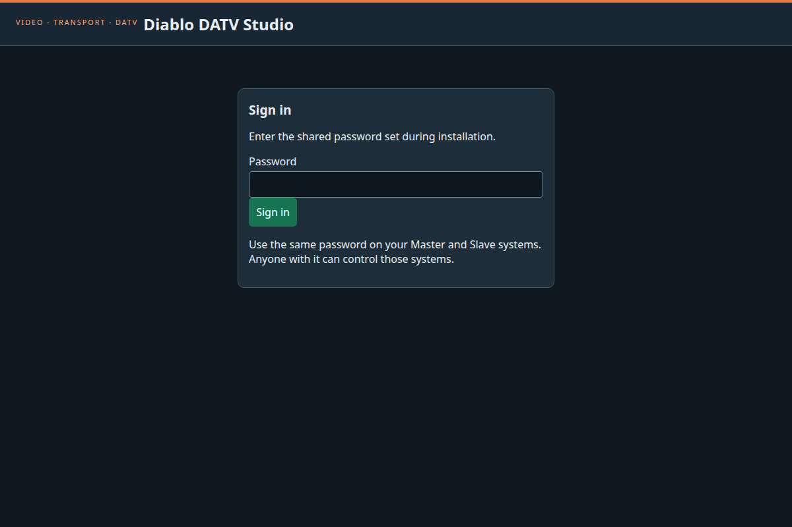

# LAN access — one shared password, no SSH tunnel

## First installation

Run the [First start wizard](FIRST_START.md). Choose a **12–128 byte shared
password** when asked, and repeat it. A long, unique passphrase is easiest to type.
This is not your Linux login password. Password characters are hidden while typing.

Setup prints an address such as **`https://192.168.3.33:8443/`**. Open **your
printed address** in a browser on any computer on the same LAN. Check the locally
issued certificate's SHA-256 fingerprint against setup's output on the first
visit, trust that certificate for this host, then sign in. No SSH tunnel is used.
Do not blindly accept a different fingerprint on a later visit.

A matching fingerprint can also be displayed on the Diablo Linux computer:

```sh
source "$HOME/.local/share/diablo-datv-studio/diablo.env"
openssl x509 -in "$PORTSDOWN_TLS_CERT" -noout -fingerprint -sha256
```

## Existing installation or password change

Stop Diablo with **Ctrl+C**. From its downloaded folder run:

```sh
cd "$HOME/Diablo-DATV-Studio" &&
bash scripts/setup-access.sh
```

Choose **STANDALONE** for one computer. Keep its detected LAN address, enter a
new shared password twice, then restart:

```sh
"$HOME/.local/share/diablo-datv-studio/bin/diablo-studio"
```

On a protected installation, leaving the new-password prompt blank keeps the
current password. A valid certificate for the same address is kept too. Changing
the address or replacing an expired certificate prints a new fingerprint.
Use `--prefix /your/install/path` for a custom installation.

**Forgot the password?** The Linux account owner can run the same setup command
and choose a new one; the old password is not needed. Restart to apply it and
invalidate old browser sessions. Back up `state/`, `security/` and `diablo.env`
together, privately. Old backups still contain old password-derived keys.

## Pair a Master and Slave



This is the actual web sign-in page. **Pairing is configured in Terminal, not
on this screen.** The password entered here is the same one saved during the
following setup on both computers. No username or separate peer token is needed.

Both computers must already have Diablo installed. If updating an older version,
complete the [Install / update steps](INSTALL.md#update-an-existing-install) first.

### 1. Stop both copies of Diablo

In each computer's running Diablo terminal, press **Ctrl+C**.

### 2. Configure the Slave (remote transmitter)

Open Terminal **on the Slave** and run:

```sh
cd "$HOME/Diablo-DATV-Studio" &&
bash scripts/setup-access.sh
```

Answer the prompts:

| Prompt | Slave answer |
| --- | --- |
| Role | `SLAVE` |
| LAN address for browser | The Slave's own LAN address; keep the detected value if correct |
| Shared password / New shared password | Enter the password you want both systems to share |
| Repeat shared password | Enter it again |

### 3. Configure the Master (video-producing computer)

Open Terminal **on the Master** and run the same command:

```sh
cd "$HOME/Diablo-DATV-Studio" &&
bash scripts/setup-access.sh
```

| Prompt | Master answer |
| --- | --- |
| Role | `MASTER` |
| LAN address for browser | The Master's own LAN address |
| Slave LAN address | The Slave's address from step 2—not the Master's address |
| Shared password / New shared password | Enter **exactly the same password** you entered on the Slave |
| Repeat shared password | Enter it again |

Type only the address, for example `192.168.3.232`, in the address prompts—not
`https://`, a port number, or an SRT URL. Use your actual device addresses.
On an already protected install, a blank password keeps that computer's existing
password; it does **not** copy the other computer's password.

### 4. Start the Slave, then the Master

Run this **on each computer**, leaving both terminals open:

```sh
"$HOME/.local/share/diablo-datv-studio/bin/diablo-studio"
```

Open **MASTER's printed HTTPS address** in your browser, verify its certificate
fingerprint on the first visit, and sign in with the shared password. Peer status
should show **MASTER · linked**, configuration ready and fresh Slave telemetry.
You can open SLAVE's HTTPS address separately and sign in with that same password;
its controls remain locked except for E-Stop.

The computers authenticate their peer connection automatically after startup;
browser sign-in lets you use the controls but is not what establishes the peer
link. **Linked confirms control communication, not video reception or RF output.**
If it does not link, check matching passwords, roles, the Slave address, and TCP
8181 access to the Slave. No SSH tunnel is needed.

There is no separate token to generate or copy. The password derives the key
used for **TLS-authenticated peer control**. A different password cannot connect.
The Slave remains **IPTS over SRT only**; its web controls stay locked except for
local E-Stop, which also requires a signed-in browser. A password does not bypass
valid-video gates, output configuration, or hardware requirements.

**Handover:** stop the old MASTER before starting a replacement MASTER with the
same password. A second connection cannot evict an active MASTER. Handover,
reconnection and sign-in never start TX automatically. See [peer control](peer-control.md)
for heartbeat behavior and the remaining live-output integration work.

If you change the shared password, change it on **both** peers while stopped.
Anyone knowing it can operate all matching-password systems; there are no
individual accounts, read-only users or per-user audit identities.

## What is protected

- **HTTPS TCP 8443:** GUI, settings, commands, logs/SSE and every preview require
  a valid browser session. The login page and its CSS/JavaScript are public.
- **Peer TLS TCP 8181 on SLAVE:** password-derived pre-shared-key authentication
  happens before a connection reaches the control daemon. Master and Slave
  authenticate with the same key; no browser certificate setup is needed for peers.
- Cookies are Secure, HttpOnly and SameSite=Strict. Sessions last at most eight
  hours, expire on daemon restart, and are invalidated by **Sign out**. Logout and
  expiry close that session's event/video connections. They **do not stop TX**;
  use E-Stop/Stop TX for that. Password hashing runs in a bounded background worker
  so a slow login does not block control heartbeats.
- The saved record contains a salted PBKDF2-SHA256 verifier and a separately
  derived peer key, not the plaintext password. Records, keys and setup backups
  are user-private. Do not publish the `security/` directory or environment files.

The implementation uses the existing ucode daemon and minimal C tools plus
OpenSSL and **stunnel4**. No Python, Node.js or frontend framework is needed to run it.
This is LAN access control, not an independently audited Internet-facing service.
Do not expose these ports through your router to the public Internet.

### Local trust and media are separate

The main HTTP backend is loopback-only (`127.0.0.1:8080`); trusted local helpers
use loopback HTTP `18080` without a browser login. Peer plaintext internals use
loopback `18181`/`18182`. Local OS accounts/processes are trusted. Never forward
these internal ports to the LAN. Install/run as a dedicated trusted Linux user
on shared computers.

**The GUI/peer password is not automatically an SRT passphrase.** SRT media,
UDP TS, RTSP cameras and optional external preview consumers retain their own
access settings. Restrict those ports to the intended senders; separately
configure media encryption when required. The current sender URLs are not made
password-protected by signing into the GUI. A browser on MASTER must separately
sign into SLAVE to load its optional protected remote preview; cross-origin
cookie rules may prevent embedding it. Open SLAVE directly if needed.

### Ports and troubleshooting

| Symptom | Check |
| --- | --- |
| Cannot open the page | Use `https://` and the printed LAN IP/port; keep Diablo running; allow TCP 8443 from your LAN in the host firewall if necessary |
| Incorrect password | Use the Diablo shared password, not your Linux password; after repeated failures wait 30 seconds |
| Peer not linked | Same password on both, MASTER points to SLAVE, SLAVE role selected, TCP 8181 reachable, previous MASTER stopped |
| Login unexpectedly reappears | Session expired or daemon restarted; sign in again |
| Changed IP / HTTPS port | Stop Diablo, rerun `setup-access.sh --host NEW_IP --https-port 8443`, verify the printed fingerprint |
| Old install lacks stunnel | Run the normal `install-diablo.sh` update to install the new dependencies, then `setup-access.sh` |

The setup scripts do not edit firewall rules, enable boot services, or start
RF/ASI output. Low-level developers may explicitly use `first-start.sh
--local-only` without LAN exposure; this does not remove existing HTTPS settings.
