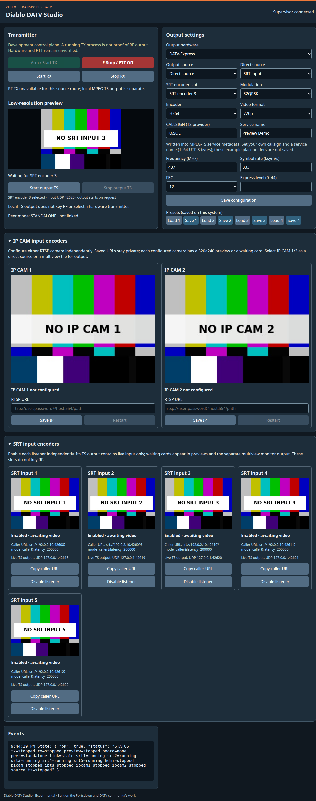
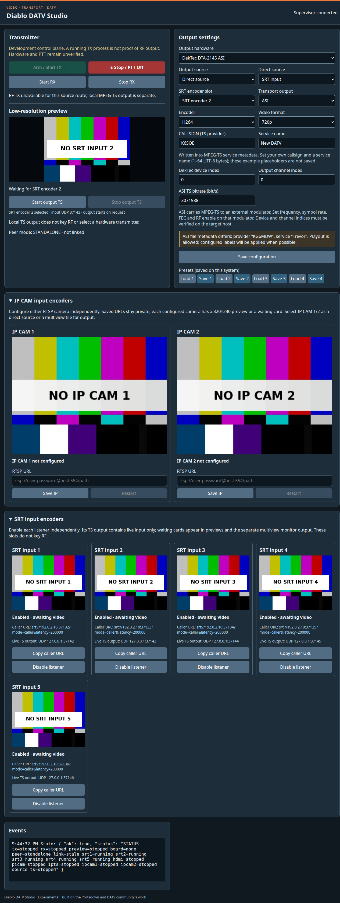
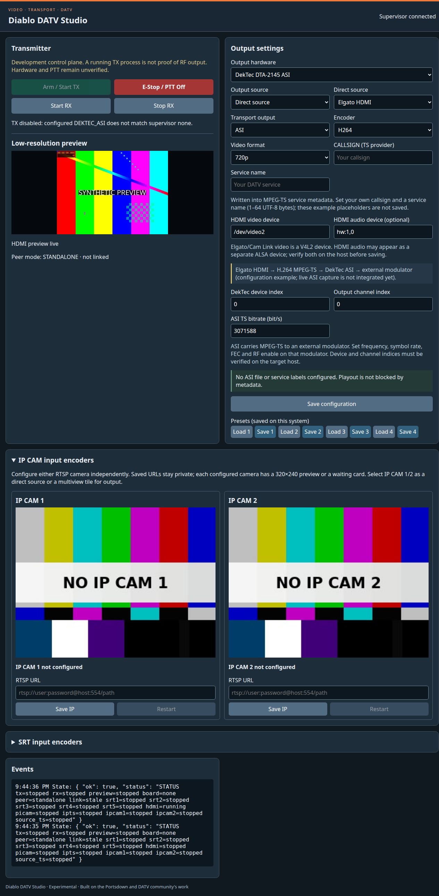
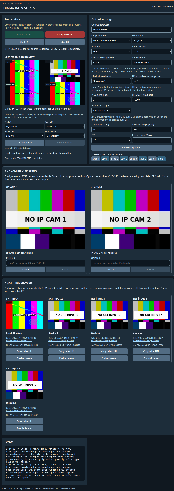
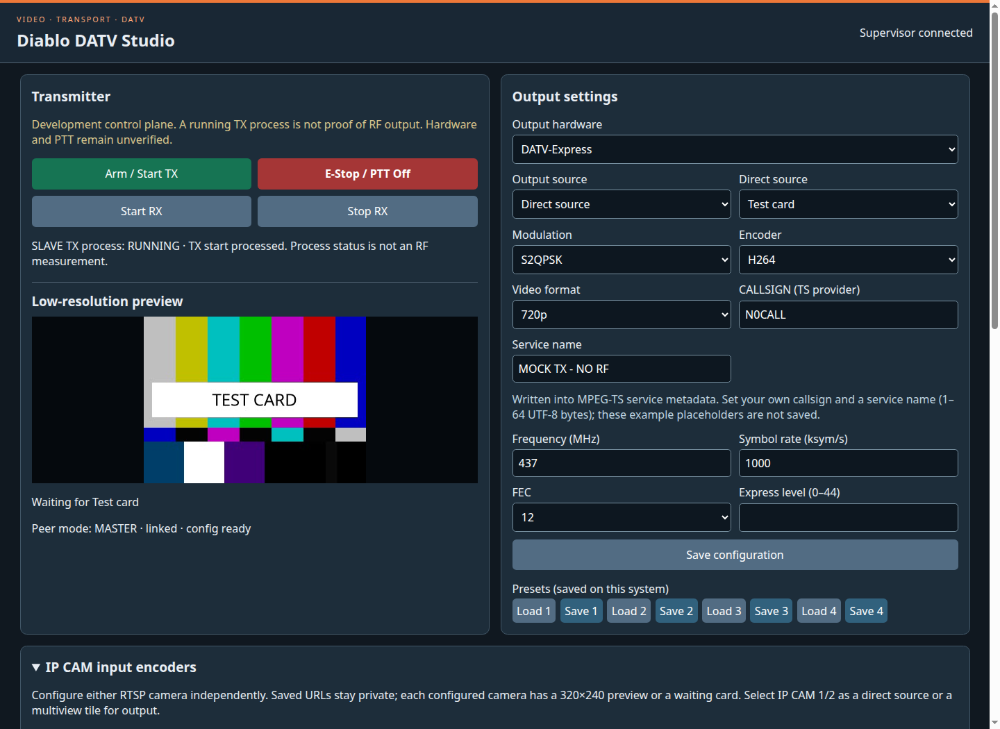
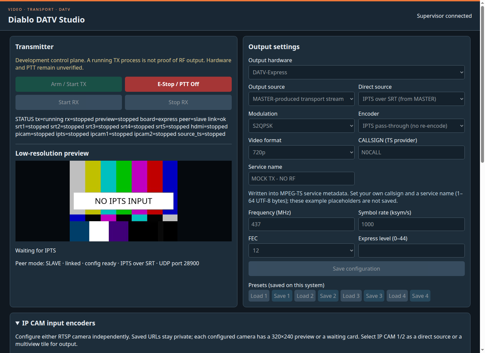
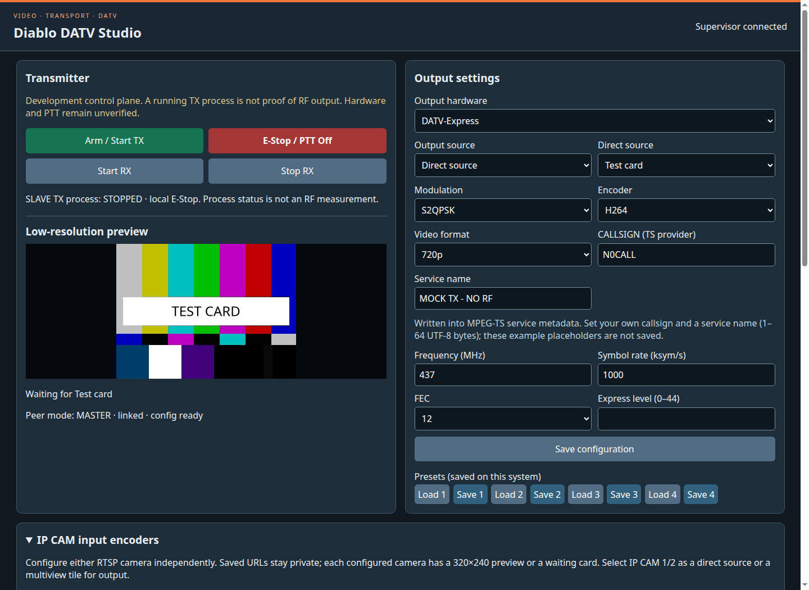
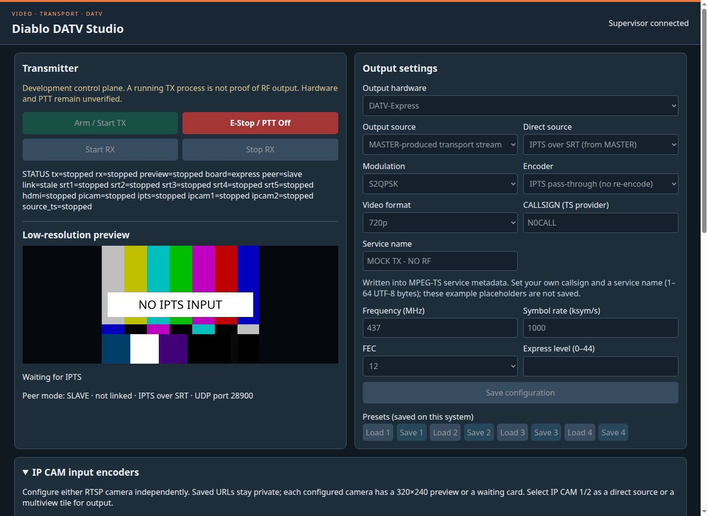
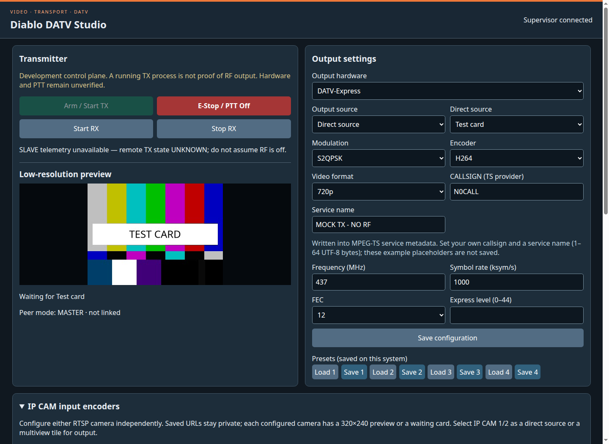

# Diablo DATV Studio screenshot gallery

These are **actual Chromium captures of the new Diablo web GUI**, not painted
mockups. The original six fixtures were regenerated during repository migration
with `PORTSDOWN_BOARD=none`. The peer captures below use real VideoLP3D/TANK
control instances with a simulated Express board and mock TX/safe-off scripts.
**No RF or physical ASI output was enabled in any capture.**
Synthetic preview frames are labeled in the images. Camera endpoints and station
labels in the fixtures are examples, not installed defaults; `192.0.2.10` is a
documentation-only address. Random test ports are not the installation defaults.

| Screenshot | What it demonstrates | Use in docs |
| --- | --- | --- |
| [Direct SRT](#direct-srt-and-five-input-encoders) | Selected SRT slot, preview in TX column, waiting cards, caller links | README / first SRT setup |
| [ASI settings](#asi-output-and-metadata-flag) | ASI bitrate/device/channel, advisory metadata mismatch | ASI guide |
| [Elgato HDMI](#elgato-hdmi-configuration) | V4L2/ALSA controls, low-resolution preview | Capture setup |
| [Mixed multiview](#mixed-source-multiview) | Equal quadrants, four selectors, concurrent source settings | Multiview guide |
| [IP cameras](#two-ip-cam-input-encoders) | Two independent input cards and Save IP / Restart | RTSP setup |
| [Peer control](#two-host-peer-control-and-link-loss) | Real two-host MASTER/SLAVE, IPTS/SRT-only SLAVE, locked controls, heartbeat loss/disconnect | Peer control guide |
| [Mobile](#mobile-layout) | Single-column responsive controls at 390 px viewport | UI/device support |

## Direct SRT and five input encoders

Encoder 3 is selected for local output; all five listeners are represented in the
fixture. The waiting cards are preview-only and do not authorize RF TX.

## ASI output and metadata flag

A synthetic local TS has different service labels. The amber warning is advisory:
playout is not blocked by a mismatch, and configured labels are applied when
possible. Device/channel/rate shown are examples. This is not a card output test.

## Elgato HDMI configuration

The fixture uses `/dev/video2` and `hw:1,0` as examples; it does not open a real
Elgato. The injected 320×240 preview demonstrates placement and source selection.
Real HDMI capture and live HDMI-to-ASI acceptance are still needed.

## Mixed-source multiview

HDMI, IPTS and SRT preview frames are synthetic; Pi Camera has no input and shows
its waiting card. The four selectors and required device/port settings are live
GUI controls. Current composed TS is a **5 fps video-only monitor**, not a
full-resolution production mixer with audio.

## Two IP CAM input encoders

Both camera cards receive **synthetic MJPEG** for this reproducible screenshot.
No real camera login is displayed or included. The earlier single-camera RTSP
4K-to-720p test remains evidence in the technical notes, but this image is not
proof of two simultaneous physical cameras.

## Mobile layout

390 px Chromium viewport; full page shown. The capture verifies no horizontal
layout overflow, not a test of a physical phone's touchscreen.

## Two-host peer control and link loss

**Completed 2026-11-24:** VideoLP3D (x86-64) as MASTER, TANK (AArch64) as
SLAVE, application revision `5264929`. Direct LAN TCP carries control; separate
SRT carries the MASTER-produced TS. SLAVE is restricted to **IPTS over SRT**,
not a mirrored copy of MASTER's camera or multiview selection.

[Peer configuration, test method and limits](peer-control.md) ·
[Machine-readable results](testing/peer-two-host-2026-11-24.json)

### VideoLP3D MASTER — linked

MASTER owns source production. Its transmitter panel now shows **SLAVE TX
process: RUNNING**, received through bidirectional telemetry, rather than the
MASTER's local process status. The process is a test double, not a physical transmitter.

### TANK SLAVE — IPTS over SRT only

SLAVE accepts the finished MASTER TS, without video re-encoding. The screen
shows its only source choice, locked settings, and enabled local E-Stop.
`tx=running` here is a **mock sleep process**, not RF or ASI output. The finite
720p24 H.264/AAC SRT delivery test passed separately; the preview was not wired
to that test receiver, so it correctly shows **NO IPTS INPUT**. This image is
not proof of an integrated valid-video-to-RF gate.

### MASTER — local SLAVE E-Stop acknowledged

The E-Stop was issued locally on TANK. Returned telemetry cleared MASTER's
`tx_requested` and changed its display to **STOPPED · local E-Stop**. An exited
SLAVE TX process was also detected and reported in the test.

### TANK — heartbeat loss with TCP still connected

Freezing MASTER's control daemon stopped mock TX in **1.246 s**. `linked` only
means the socket remains connected; `link=stale` and `tx=stopped` show the
watchdog condition. Clearer combined health/status reporting remains needed.

### TANK — disconnected MASTER

Disconnect stopped mock TX in **0.029 s** in this run. Resume/reconnect did not restart TX without an explicit request.
Both instances and all owned test processes/tunnels were stopped afterward.

### MASTER — return telemetry unavailable

SLAVE's ucode daemon was frozen while its C supervisor continued running.
MASTER invalidated its remote state, disabled Start and stopped heartbeats.
The SLAVE C watchdog stopped mock TX. After resume/reconnection, TX remained
stopped. **UNKNOWN is not presented as confirmed RF-off.**

No peer token or camera credentials appear in these captures. These satisfy the
**isolated two-host UI/link-loss screenshot requirement**, not physical RF
shutdown, media-loss interlocking, network-impairment endurance or reboot testing.

## Reverse roles: TANK MASTER → VideoLP3D SLAVE

**Completed 2026-11-25 UTC (Nov 24 PST)** at revision `5264929`.
[All 16 recorded checks passed](testing/peer-two-host-reverse-2026-11-25.json),
including finite 720p24 H.264/AAC SRT delivery, telemetry and watchdog behavior.

TANK shows **SLAVE TX process: STOPPED · local E-Stop**, and its pending request
is cleared. This is returned process telemetry, not a physical RF measurement.

VideoLP3D runs only the mock transmitter. Its only source is MASTER-produced
IPTS over SRT; settings remain locked and local E-Stop is available. The separate
finite SRT receiver is not connected to the preview, hence **NO IPTS INPUT**.
Heartbeat loss stopped mock TX in 1.460 s; disconnect in 0.031 s. No automatic
restart occurred. RF/ASI were not enabled, and owned test processes were stopped.

## Screenshots still needed

| Needed capture | Why / where to publish it | Prerequisite |
| --- | --- | --- |
| Real HDMI preview plus decoded TS at receiver | Capture guide, replace synthetic HDMI example | Free Elgato/ALSA devices and live output integration |
| Actual ATEM SRT live → loss → recovery | SRT setup / reliability section | ATEM feeding supported TS and a bounded test |
| Two simultaneous real RTSP cameras | Camera setup / performance | Second camera, private URLs kept hidden |
| Pi Camera preview / capture handoff | Pi setup guide | Camera not owned by another application |
| Physical ASI connection and independent analyzer | ASI acceptance guide | Port-2 hookup, modulator RF off, receiver/analyzer; card-only playout passed with BNC disconnected (see [ASI report](asi-output.md)) |
| RF receiver lock, PTT-off on input loss | Board-specific transmitter guide | Interlocked launcher, board and supervised RF test setup |
| Actual 32-bit and 64-bit Pi clean installs | Platform acceptance guide | Spare images/devices; not inferred from native builds |

Track real-source captures in [issue #4](https://github.com/mathisono/Diablo-DATV-Studio/issues/4),
ASI in [issue #2](https://github.com/mathisono/Diablo-DATV-Studio/issues/2), RF in
[issue #1](https://github.com/mathisono/Diablo-DATV-Studio/issues/1), and peer/platform
acceptance in [issue #6](https://github.com/mathisono/Diablo-DATV-Studio/issues/6).

Do not replace these missing captures with simulated “success” screenshots.
When a real test becomes available, record source, host, software commit, test
conditions and limitations next to the image. New captures must not show camera
credentials, peer tokens, or private operator files.

## Regenerate

See [DEVELOPMENT.md](DEVELOPMENT.md#screenshots). The checked-in
`scripts/dev/capture-gui.py` creates all six fixtures with isolated ports and
processes, captures Chromium, and stops its owned processes afterward.

For the real two-host peer captures, use the separate [peer test harness](peer-control.md#reproduce-the-isolated-test); the six-fixture capture script does not regenerate them.
