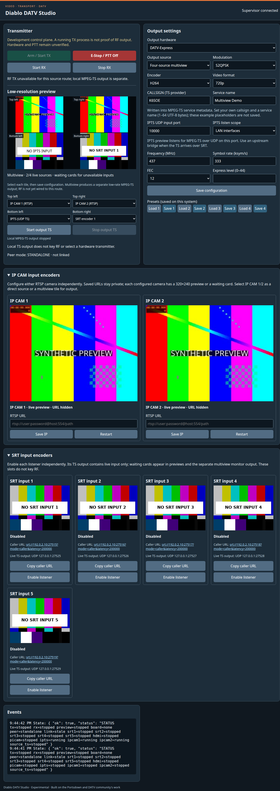
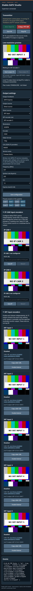

# Diablo DATV Studio screenshot gallery

These are **actual Chromium captures of the new Diablo web GUI**, not painted
mockups. They were regenerated during the repository migration. The supervisor
was set to `PORTSDOWN_BOARD=none`; **no RF or physical ASI output was enabled**.
Synthetic preview frames are labeled in the images. Camera endpoints and station
labels in the fixtures are examples, not installed defaults; `192.0.2.10` is a
documentation-only address. Random test ports are not the installation defaults.

| Screenshot | What it demonstrates | Use in docs |
| --- | --- | --- |
| [Direct SRT](#direct-srt-and-five-input-encoders) | Selected SRT slot, preview in TX column, waiting cards, caller links | README / first SRT setup |
| [ASI settings](#asi-output-and-metadata-flag) | ASI bitrate/device/channel, advisory metadata mismatch | ASI guide |
| [Elgato HDMI](#elgato-hdmi-configuration) | V4L2/ALSA controls, low-resolution preview | Capture setup |
| [Mixed multiview](#mixed-source-multiview) | Equal quadrants, four selectors, concurrent source settings | Multiview guide |
| [IP cameras](#two-ip-cam-input-encoders) | Two independent input cards and Save IP / Restart | RTSP setup |
| [Mobile](#mobile-layout) | Single-column responsive controls at 390 px viewport | UI/device support |

## Direct SRT and five input encoders

Encoder 3 is selected for local output; all five listeners are represented in the
fixture. The waiting cards are preview-only and do not authorize RF TX.

## ASI output and metadata flag

A synthetic local TS has different service labels. The amber warning is advisory:
playout is not blocked by a mismatch, and configured labels are applied when
possible. Device/channel/rate shown are examples. This is not a card output test.

## Elgato HDMI configuration

The fixture uses `/dev/video2` and `hw:1,0` as examples; it does not open a real
Elgato. The injected 320×240 preview demonstrates placement and source selection.
Real HDMI capture and live HDMI-to-ASI acceptance are still needed.

## Mixed-source multiview

HDMI, IPTS and SRT preview frames are synthetic; Pi Camera has no input and shows
its waiting card. The four selectors and required device/port settings are live
GUI controls. Current composed TS is a **5 fps video-only monitor**, not a
full-resolution production mixer with audio.

## Two IP CAM input encoders

Both camera cards receive **synthetic MJPEG** for this reproducible screenshot.
No real camera login is displayed or included. The earlier single-camera RTSP
4K-to-720p test remains evidence in the technical notes, but this image is not
proof of two simultaneous physical cameras.

## Mobile layout

390 px Chromium viewport; full page shown. The capture verifies no horizontal
layout overflow, not a test of a physical phone's touchscreen.

## Screenshots still needed

| Needed capture | Why / where to publish it | Prerequisite |
| --- | --- | --- |
| Real HDMI preview plus decoded TS at receiver | Capture guide, replace synthetic HDMI example | Free Elgato/ALSA devices and live output integration |
| Actual ATEM SRT live → loss → recovery | SRT setup / reliability section | ATEM feeding supported TS and a bounded test |
| Two simultaneous real RTSP cameras | Camera setup / performance | Second camera, private URLs kept hidden |
| Pi Camera preview / capture handoff | Pi setup guide | Camera not owned by another application |
| Physical ASI connection and independent analyzer | ASI acceptance guide | Port-2 hookup, modulator RF off, receiver/analyzer |
| RF receiver lock, PTT-off on input loss | Board-specific transmitter guide | Interlocked launcher, board and supervised RF test setup |
| Two-host Master/Slave UI with link loss | Peer control guide | Isolated two-host control test, secrets redacted |
| Actual 32-bit and 64-bit Pi clean installs | Platform acceptance guide | Spare images/devices; not inferred from native builds |

Track real-source captures in [issue #4](https://github.com/mathisono/Diablo-DATV-Studio/issues/4),
ASI in [issue #2](https://github.com/mathisono/Diablo-DATV-Studio/issues/2), RF in
[issue #1](https://github.com/mathisono/Diablo-DATV-Studio/issues/1), and peer/platform
acceptance in [issue #6](https://github.com/mathisono/Diablo-DATV-Studio/issues/6).

Do not replace these missing captures with simulated “success” screenshots.
When a real test becomes available, record source, host, software commit, test
conditions and limitations next to the image. New captures must not show camera
credentials, peer tokens, or private operator files.

## Regenerate

See [DEVELOPMENT.md](DEVELOPMENT.md#screenshots). The checked-in
`scripts/dev/capture-gui.py` creates all six fixtures with isolated ports and
processes, captures Chromium, and stops its owned processes afterward.
