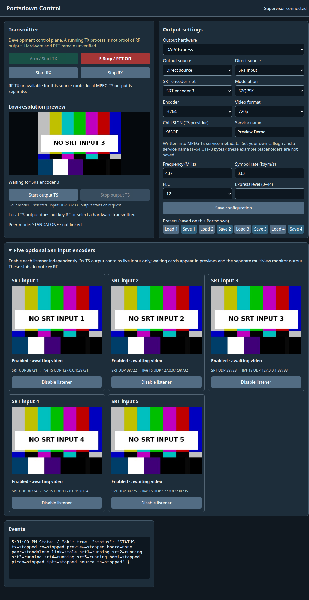
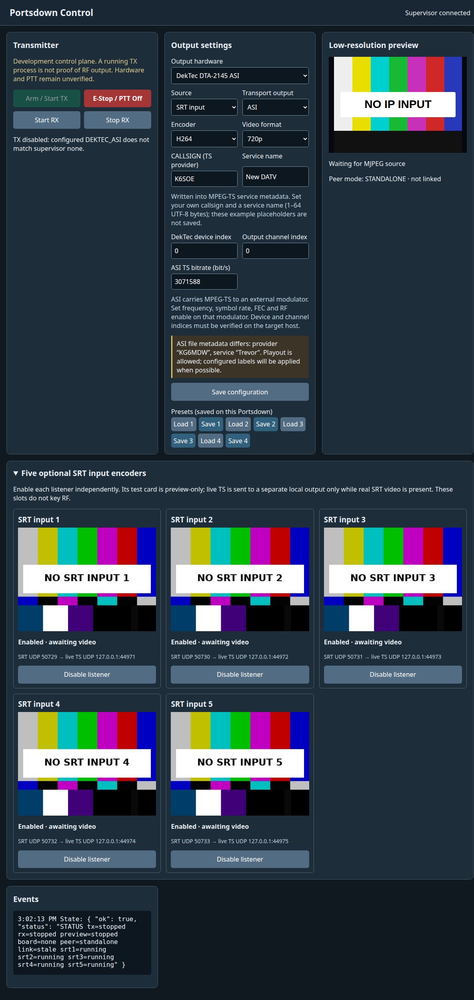
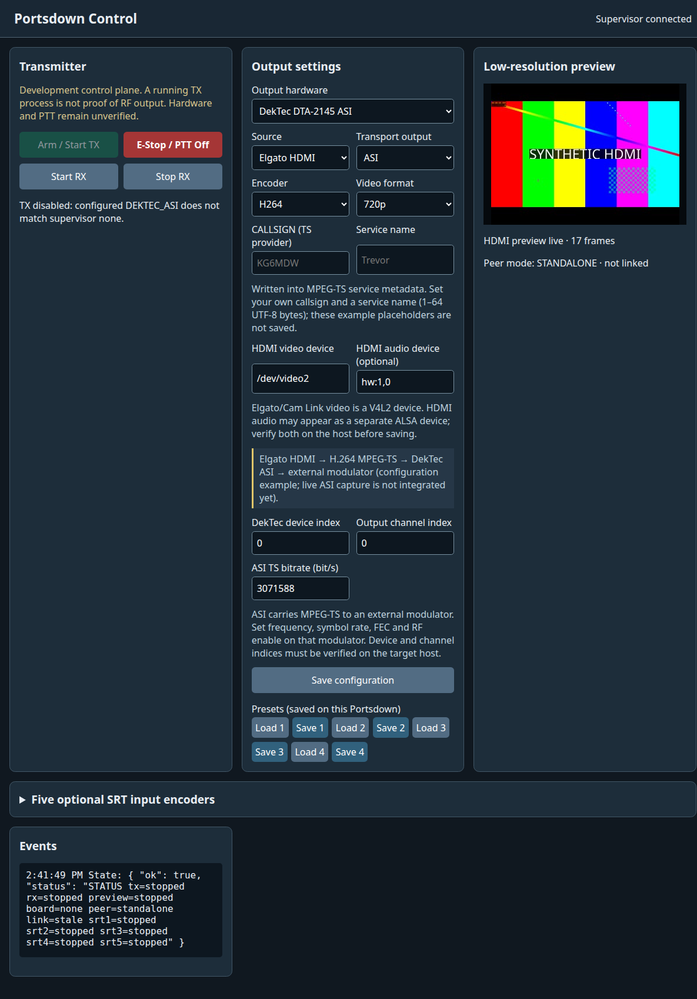

# Headless `ucode` control plane — experimental, not a transmitter release

This branch adds a **parallel** web/control implementation that does not use
`rpidatvgui`, a touchscreen, `/dev/fb0`, or `/touchscreen/`. It does **not**
remove those legacy paths yet. Do not enable it as a replacement for a working
Portsdown transmitter until board-specific launch and safe-off paths have been
verified on real hardware.

## Web GUI screenshot



Captured from an isolated local run with all five SRT listeners enabled and
waiting for video. TX was disabled (`PORTSDOWN_BOARD=none`); no RF or physical
Portsdown display was involved.



The ASI view was also captured locally with `PORTSDOWN_BOARD=none`; its
device 0/channel 0 and 3,071,588 bit/s values are **example settings**, not
enumerated hardware. Its amber ASI metadata flag compares a synthetic TS file
with example saved labels; the mismatch is advisory and does not prevent
playout. SRT port numbers shown are temporary test ports.



This **configuration example** selects Elgato HDMI video (`/dev/video2`),
optional ALSA audio (`hw:1,0`), H.264 at 720p, and DekTec ASI output at
3,071,588 bit/s. The device names and indices are illustrative, not detected
on the current host. `KG6MDW` and `Trevor` are unsaved placeholder examples
in the screenshot; the operator must enter their own values. The screenshot's 320×240 preview is a **synthetic test
feed**, not an Elgato capture or physical ASI test. When HDMI is selected,
the GUI shows the separate V4L2 and ALSA fields and live preview when frames
arrive; it falls back to **NO HDMI INPUT** when they stop. The five SRT slots
remain available in a collapsed section. The legacy Express capture path
recognizes `modeinput=HDMI`, `expresshdmidevice`, and `expressaudiodevice`,
but this headless ASI route is **not yet a live encoder or playout path**.
The standby MJPEG preview launcher reads the saved `expresshdmidevice` for
HDMI, scales to 320×240 at 5 fps, and restarts when the saved source/device
changes. It does not play a saved TS file. `PORTSDOWN_VIDEO_DEVICE` remains
the fallback for non-HDMI standby preview. Set `PORTSDOWN_HDMI_INPUT_FORMAT`
to `mjpeg` or `yuyv422` only when the capture device requires a format
override. The Express HDMI capture helper can also send a low-resolution
MJPEG tap from the **same FFmpeg capture process** while it generates TS when
`PORTSDOWN_MJPEG_PORT` is set; it never opens the V4L2 device a second time.
That tap was checked with a synthetic source only. The new headless supervisor
does not yet install or select the Express TX launcher, and physical Elgato
capture, audio, and RF remain unverified.

## Implemented

- `control/tx-super.c`: Unix socket commands `START_TX`, `STOP_TX`, `START_RX`,
  `STOP_RX`, `START_PREVIEW`, `STOP_PREVIEW`, `STATUS`; child process groups;
  captured log lines; 500 ms TERM→KILL stop; explicit safe-off hook;
  `/dev/video0` preview handoff. A slave supervisor additionally requires
  `PEER_HB` and stops TX within 1.5 seconds of missed heartbeats.
- `control/ucode/`: persistent `uloop`/`socket` HTTP server, atomic config and
  preset updates (through the small C `config-store` helper), SSE state/log
  events, 128 KiB-capped MJPEG latest-frame fan-out, and token-protected
  Master/Slave NDJSON control. Video never uses the peer-control socket.
- `www/`: no-framework responsive dashboard, four server-side presets,
  320×240 preview with a **NO IP INPUT** placeholder, and an E-Stop button.
  An optional remote-slave preview URL can be configured separately.
- The Output settings form asks for **CALLSIGN** and **Service name**. The
  callsign becomes MPEG-TS `service_provider`; the service name becomes
  MPEG-TS `service_name`. `KG6MDW` / `Trevor` are example placeholders, **not**
  saved defaults. Enter the actual transmitting station's callsign (3–20
  uppercase letters, digits, or `/`, with a digit) and a printable service
  name of 1–64 UTF-8 bytes. These settings are saved in
  `portsdown_config.txt`, included in presets and peer configuration, and
  passed to FFmpeg on the current SRT/IPTS and local Express TS-producing
  paths. An older config without both values must be completed in the GUI
  before those new paths will generate TS. This metadata is not itself a
  substitute for any required on-air station identification.
- Five independently enabled SRT source slots (`control/srt-slot.sh`) each
  accept MPEG-TS over SRT, encode live video/audio to a local source-resolution
  H.264/AAC MPEG-TS output, and provide a 320×240 aspect-preserving MJPEG
  preview. Each preview serves a
  numbered **NO SRT INPUT** test card while its listener has no valid video,
  then returns to the card after input loss. The test card is **preview-only**:
  it never generates TS or satisfies a transmitter's live-input gate.
- A **DekTec DTA-2145 ASI** output-hardware choice is available for an
  x86-64/PCIe host. It exposes device index, output channel, and MPEG-TS/ASI
  bitrate. It does **not** offer RF frequency, symbol rate, or FEC controls:
  those belong to the external modulator. `control/dektec-asi-file.sh` is a
  finite-file TSDuck playout launcher for hardware bring-up, not a verified
  live encoder or an RF safety interlock. `PORTSDOWN_BOARD=dektec_asi` must
  match `modeoutput=DEKTEC_ASI`, and the supervisor still requires an
  independently verified safe-off hook before it will start TX.
  The ASI file launcher **does not reject** a file because its service
  metadata differs. The web GUI shows a non-blocking match/mismatch/unknown
  flag for the configured file. During playout, TSDuck's `svrename` processor
  applies the saved callsign and service name to detected services' SDT
  descriptors when available; it does not decode/re-encode video or rewrite
  the source file. If service metadata or the processor is unavailable, the
  original TS can still play. An offline test with a local TSDuck build
  confirmed that `svrename` changed the service tags while retaining packet
  count and PMT/PCR PIDs; physical DekTec output is still unverified.
- `systemd/`: uninstalled service templates. `portsdown-tx-super.service`
  uses `ExecStopPost` as a second attempt to invoke the safe-off hook if the
  supervisor dies while systemd is alive.

The HTTP server listens on **127.0.0.1** only. It checks `Host` and requires
`X-Portsdown-Control: 1` on POST requests to block cross-origin forms and
simple DNS-rebinding attempts. Put authentication and TLS in front of it
before exposing control to another computer; set `PORTSDOWN_ALLOWED_HOST` to
the reverse proxy's exact Host value if needed, and do not add permissive CORS.
The Master/Slave
token is sent over TCP without TLS; use a private LAN/VPN or a protected
tunnel. `PORTSDOWN_PEER_BIND` defaults to loopback, so remote peers require
an explicit private-interface address.

## What is not integrated

- **No live RF launcher is provided.** `PORTSDOWN_TX_EXEC` and
  `PORTSDOWN_SAFE_OFF_EXEC` must name absolute, executable, board-verified
  programs. With either unset, `START_TX` fails closed. The C supervisor
  compares `PORTSDOWN_BOARD` with `modeoutput` on every start. Changing boards
  in the web UI requires reconfiguring/restarting the supervisor before TX.
- **ASI is not DVB-S/S2 modulation.** The DTA-2145 delivers MPEG-TS packets
  over ASI to an external modulator. The SRT slots' local UDP TS outputs are
  not yet wired to this ASI launcher; the launcher plays one analyzed TS file
  and stops. FFmpeg/QSV live encoding, TS remultiplexing/stuffing, output
  timing, driver/DTAPI/TSDuck installation, card enumeration, physical ASI
  waveform, downstream receive, and reboot persistence all need verification
  on the actual DekTec host. The historical device 0/channel 0/port 2 and
  7,621,339 bit/s are reference observations, not assumed current settings.
  Keep external modulator RF disabled during bring-up. TANK is ARM64 and has
  no DekTec card; it is not a hardware acceptance target for this path.
- Existing DATV-Express, Pluto, and LimeSDR code remains in the repository,
  including legacy DVB-S/S2 paths. The new control plane does **not yet**
  drive all their source/encoder/RF paths. Existing Python interlock scripts
  are still in the legacy transmitter; this branch has no Python/Node runtime
  in the **new** control plane, but is not yet a Python-free Portsdown tree.
  Legacy `avc2ts` and unchanged pass-through tools may preserve their original
  service descriptors rather than use the new GUI fields. Inspect their TS
  with `ffprobe -show_programs` before sending it to a modulator; the ASI
  GUI flags a mismatch but does not block playout. Other legacy outputs are
  not yet flagged.
- A native DVB-S2 QPSK experimental DATV-Express backend exists; no
  DVB-S2X backend was found in this branch. DVB-S2X is therefore **not**
  offered by the capability map.
- The optional idle-preview launcher is provided. The Express HDMI capture
  helper has an opt-in same-input TS/MJPEG fan-out for preview during TX,
  exercised with a synthetic source; other capture/backend combinations
  still need their own TX preview integration. The headless supervisor does
  not yet route its TX command into these legacy Express paths. RF must stay
  off until valid live TS is received and stop when that input disappears.
- The five SRT encoders are **not** connected to a board or the RF TX gate.
  Their enable/disable state is held by the running supervisor (not persisted
  across its restart). Real ATEM sources and five-way on-board CPU/thermal
  performance remain unverified.
- The GPIO and DATV-Express USB/PTT behavior, Pluto/Lime safe-off hooks,
  native video devices, real RF output, and UI behavior on a complete
  Portsdown install have not been tested. Software cannot guarantee PTT-off
  after power loss, kernel failure, or a board that latches TX independently;
  a hardware interlock/watchdog is required for that guarantee.
- The code is Linux/POSIX-oriented and independent of **Buster and a physical
  display**, not independent of every operating system.

## Offline development run

The new runtime requires `ucode` with its `fs`, `socket`, and `uloop` modules,
`libubox`, FFmpeg for an actual preview, and a C compiler. `ucode` is common
on OpenWrt but is not preinstalled on the tested Debian/Ubuntu hosts. Build
`libubox` then `ucode` from their upstream sources, with `libjson-c-dev` and
CMake; ensure `ULOOP_SUPPORT=ON` and `SOCKET_SUPPORT=ON`. The local spike used
libubox commit `a396f38a8568a1d670c240465cd8d24fdfdf6463` and ucode commit
`a2c42eac6369a0bba0315007c7dc7b7130275340` in `/tmp`, without changing
the system installation. Do not infer that these commits are packaged for
Trixie.

From the checkout, this example starts an **unarmed local UI**. It does not
install a service or enable any TX backend:

```sh
make -C control
export PORTSDOWN_DIR="$PWD"
export PORTSDOWN_RUN_DIR="$(mktemp -d)"
export PORTSDOWN_TX_SOCKET="$PORTSDOWN_RUN_DIR/tx.sock"
export PORTSDOWN_HTTP_PORT=8080
export PORTSDOWN_MJPEG_PORT=8082
./control/tx-super &
ucode -L "$PORTSDOWN_DIR/control/ucode" "$PORTSDOWN_DIR/control/ucode/daemon.uc"
```

To make the five software-only SRT listeners available, export
`PORTSDOWN_SRT_EXEC="$PORTSDOWN_DIR/control/srt-slot.sh"` **before** starting
`tx-super`. The web UI has an Enable/Disable button for each slot. By default:

| Slot | SRT caller destination | Live TS output (loopback UDP) | MJPEG preview |
| --- | --- | --- | --- |
| 1 | `srt://TANK:9101?mode=caller` | `127.0.0.1:12001` | `/api/video/srt/1` |
| 2 | `srt://TANK:9102?mode=caller` | `127.0.0.1:12002` | `/api/video/srt/2` |
| 3 | `srt://TANK:9103?mode=caller` | `127.0.0.1:12003` | `/api/video/srt/3` |
| 4 | `srt://TANK:9104?mode=caller` | `127.0.0.1:12004` | `/api/video/srt/4` |
| 5 | `srt://TANK:9105?mode=caller` | `127.0.0.1:12005` | `/api/video/srt/5` |

The SRT input accepts a live MPEG-TS carrying video (audio optional). Its
**IPTS output retains the caller's raster**: synthetic H.264 inputs at
640×480/25, 1280×720/24, and 1920×1080/15 were probed at the same respective
output resolutions. The separate 320×240 MJPEG preview letterboxes 16:9
sources. TS outputs are **local-only and absent when input is absent**; they
are not automatically DVB-S2 modulated or transmitted. The software encoder
still targets 800 kbit/s H.264 video plus 64 kbit/s AAC when audio is present,
so 1080p picture quality at that bitrate may be limited. Allow for FEC/mux
overhead before using a TS in a 1000 ksym/s mode.
`PORTSDOWN_SRT_PORT_BASE`, `PORTSDOWN_SRT_TS_PORT_BASE`, and
`PORTSDOWN_SRT_MJPEG_PORT_BASE` can change the consecutive five-port blocks;
set them identically in both service processes. The listener ports bind all
interfaces, so restrict access to trusted senders with a firewall/VPN.

Open `http://127.0.0.1:8080/` locally, or tunnel the loopback port over SSH.
For a service install, create a dedicated `portsdown` user/group, copy and
edit `control/portsdown.env.example` as `/etc/portsdown/portsdown.env`, install
`ucode`/`libubox`, and only then install the two service units. **Do not enable
the services from the example env file:** its TX executable and safe-off hook
are placeholders, not board-certified paths.

Run the bounded, hardware-free tests with:

```sh
python3 -m unittest tests/test_headless_control.py -v
```

If `ucode` is installed outside `PATH`, set `UCODE` and `UCODE_MODULE_DIR`.
The standard-library Python test runner is a **development-only** dependency,
not part of the headless control runtime.

On 23 November 2026, the two C utilities also compiled natively as AArch64
ELF executables in `/tmp/portsdown-headless-control-build` on TANK (Debian 13
Trixie). TANK's rover service remained active. `ucode` and the web service
were **not** installed or run there; no TX or RF test was attempted.
The five-slot supervisor revision was separately built as AArch64 in
`/tmp/portsdown-srt-control-check`; FFmpeg on TANK lists SRT input/output
support. On the development host, 14 hardware-free tests passed, including
five concurrent synthetic callers producing distinct local TS outputs and a
single-source arrival/loss test proving the MJPEG card returns and TS stops.
The 480p25, 720p24, and 1080p15 synthetic callers decoded and produced
matching-raster H.264 TS, as confirmed by `ffprobe`.
This is **not** an on-device five-encoder performance or RF result.

## Next integration gates

1. On isolated test hardware, implement and verify board-specific TX launchers
   and safe-off hooks for DATV-Express DVB-S and experimental DVB-S2, Pluto,
   and LimeSDR. Preserve valid-TS gating and loss-triggered stop. Confirm
   that the safe-off hook really dekeys the attached board.
2. Add the per-backend dual-output FFmpeg encoder and test camera contention,
   MJPEG preview, audio/video capture, and TS timing under real source changes.
3. Test the web UI and peer link on two separate Pi systems. Exercise normal
   stop, daemon kill, cable loss, stale heartbeat, board disconnect, and
   reboot. RF tests require a dummy load/attenuated receiver.
4. Migrate the remaining legacy menu operations, receiver controls, settings,
   and installer before removing `rpidatvgui` or `/touchscreen/`.
