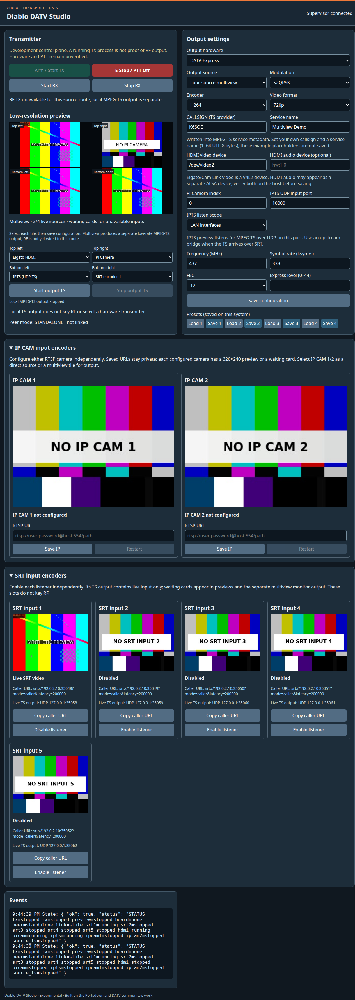

# Diablo headless `ucode` control plane — experimental

The x86-64 DTA-2145 driver installation, resolved Secure Boot blocker and QSV findings are
recorded in [LattePanda Dta driver bring-up](lattepanda-dta-driver.md).

Diablo provides a web/control implementation that does not use
`rpidatvgui`, a touchscreen, `/dev/fb0`, or `/touchscreen/`. It does **not**
remove those legacy paths yet. Do not enable it as a replacement for a working
Portsdown transmitter until board-specific launch and safe-off paths have been
verified on real hardware.

## Current web GUI captures

See the [Diablo screenshot gallery](SCREENSHOTS.md) for Direct SRT, ASI settings,
Elgato HDMI, mixed multiview, both IP CAM controls and mobile layout. All six
current captures use isolated synthetic fixtures and the real browser UI; none
claims hardware output. The gallery identifies missing real-device captures.



The HDMI preview reads the saved V4L2 device and scales it to 320×240/5 fps when
`PORTSDOWN_SOURCE_PREVIEW_EXEC` is configured. It falls back to **NO HDMI INPUT**
on loss; the legacy standby process does not reopen that same device. Physical
Elgato capture/audio and headless live ASI routing remain acceptance work.
The inherited Express capture helper supports a same-process TS/MJPEG tap using
`PORTSDOWN_MJPEG_PORT`; only synthetic capture has verified that tap.

## Implemented

- `control/tx-super.c`: Unix socket commands `START_TX`, `STOP_TX`, `START_RX`,
  `STOP_RX`, `START_PREVIEW`, `STOP_PREVIEW`, `STATUS`; child process groups;
  captured log lines; 500 ms TERM→KILL stop; explicit safe-off hook;
  `/dev/video0` preview handoff. A slave supervisor additionally requires
  `PEER_HB` and stops TX within 1.5 seconds of missed heartbeats.
- `control/ucode/`: persistent `uloop`/`socket` HTTP server, atomic config and
  preset updates (through the small C `config-store` helper), SSE state/log
  events, 128 KiB-capped MJPEG latest-frame fan-out, and token-protected
  Master/Slave NDJSON control. Video never uses the peer-control socket.
- `www/`: no-framework responsive dashboard, four server-side presets,
  low-resolution preview in the **Transmitter** column with a **NO IP INPUT**
  placeholder, and an E-Stop button.
  An optional remote-slave preview URL can be configured separately.
- **Output source** selects Direct source or Four-source multiview. Direct SRT
  offers an explicit encoder-slot selector (1–5). The selected slot is the
  only input to the local Direct SRT TS relay; starting output TS also enables
  that SRT listener. The relay copies the live MPEG-TS video/audio to the
  configured output and sends nothing until valid TS arrives. It stays armed
  across disconnects and never replays a recording. This local relay is not
  yet connected to an RF transmitter. Multiview exposes four
  independent top-left/top-right/bottom-left/bottom-right dropdowns below the
  preview. Each tile may select HDMI, Pi Camera, IPTS, IP CAM 1/2, any SRT encoder 1–5,
  or a test card; the browser preview has four equal quadrants. The saved
  selection is included in presets and Master/Slave configuration. HDMI V4L2
  device, Pi Camera index, IPTS UDP port, and loopback/LAN listen scope appear
  whenever that source type is selected in either direct or multiview mode.
  The separate **IP CAM input encoders** section always shows both RTSP URL
  controls and independent low-resolution previews, even before either camera
  is selected as an output source. Each camera has only **Save IP** and
  **Restart** buttons. Saving a URL starts its preview; Restart reconnects
  using the saved URL without changing it. The GUI accepts
  usernames/passwords and percent-encodes special characters in their URL
  components; saved URLs are never returned to the browser. They live in
  `/var/lib/portsdown/ip-cameras.conf` (mode 0600), or the path selected by
  `PORTSDOWN_IPCAM_CONFIG`, not in presets, peer config, or the legacy config.
  Use HTTPS at any reverse proxy for remote GUI access to credential fields.
  The **SRT input encoders** section keeps five independently enabled listeners
  below the camera controls and displays a copyable, complete caller URL for
  each slot.
- `control/source-preview.sh` runs selected HDMI, Pi Camera, and IPTS previews,
  plus each configured IP CAM preview, at 320×240/5 fps. HDMI uses the
  configured V4L2 device, Pi
  Camera uses `rpicam-vid` (or `libcamera-vid`), and IPTS decodes MPEG-TS on
  the configured UDP port. Each RTSP IP CAM uses TCP transport, decodes its
  source raster (including HD/UHD), and scales/pads to 320×240 at 5 fps.
  The web server supplies source-specific waiting
  cards when no live frames arrive and returns to them after loss. Set
  `PORTSDOWN_SOURCE_PREVIEW_EXEC` to enable these producers. Pi Camera and
  physical HDMI capture are not yet hardware-tested in this control plane.
  One LAN RTSP camera was probed at 3840×2160 H.264/30 fps (profile2); the
  actual `source-preview.sh` produced MJPEG frames, and bounded Direct IP CAM
  encodes produced valid 640×480/25 and **1280×720/24 H.264/AAC TS** with
  saved service metadata. Its 320×240 MJPEG/1 fps profile3 fed the GUI
  screenshot above. These were software/network tests only; a second
  physical camera and RF were not tested.
- Direct IP CAM 1/2 can start a local live MPEG-TS encode. Saved `format`
  selects 640×480/25, 854×480/25, 1280×720/24, or 1920×1080/15;
  video is H.264 (900 kb/s target) and available camera audio becomes AAC.
  The process retries after RTSP loss, emits no saved recording, and never
  keys RF. The GUI blocks RF TX for this route until board integration is
  implemented.
- `control/source-ts.sh` composes the four current low-resolution preview
  feeds (including waiting cards) with FFmpeg `xstack` into a **video-only,
  5 fps** H.264 MPEG-TS monitor output. Use **Start/Stop output TS** in the
  GUI; default output is loopback UDP
  `127.0.0.1:12010`. `PORTSDOWN_SOURCE_TS_EXEC` names the launcher;
  `PORTSDOWN_SOURCE_TS_URL` can select another FFmpeg output URL or a local
  file for testing. `PORTSDOWN_SOURCE_TS_DURATION` makes
  a finite test run. This is a low-resolution composite sourced from previews,
  **not** a full-quality multiview encoder or an RF output. An offline run with
  four mixed waiting-card inputs produced a valid 640×480 H.264 TS. Source
  capture, downstream ASI/RF, and receiver behavior still need hardware tests.
- The Output settings form asks for **CALLSIGN** and **Service name**. The
  callsign becomes MPEG-TS `service_provider`; the service name becomes
  MPEG-TS `service_name`. The form asks for your callsign and service name; **no station
  identity is saved by default**. Enter the actual transmitting station's callsign (3–20
  uppercase letters, digits, or `/`, with a digit) and a printable service
  name of 1–64 UTF-8 bytes. These settings are saved in
  `portsdown_config.txt`, included in presets and peer configuration, and
  passed to FFmpeg on the current SRT/IPTS and local Express TS-producing
  paths. An older config without both values must be completed in the GUI
  before those new paths will generate TS. This metadata is not itself a
  substitute for any required on-air station identification.
- Five independently enabled SRT source slots (`control/srt-slot.sh`) each
  accept MPEG-TS over SRT, encode live video/audio to a local source-resolution
  H.264/AAC MPEG-TS output, and provide a 320×240 aspect-preserving MJPEG
  preview. Each preview serves a
  numbered **NO SRT INPUT** test card while its listener has no valid video,
  then returns to the card after input loss. The per-slot live TS output never
  substitutes the card for absent video; the separate low-rate multiview TS
  may include the card, but it cannot satisfy an RF transmitter's live-input
  gate.
- A **DekTec DTA-2145 ASI** output-hardware choice is available for an
  x86-64/PCIe host. It exposes device index, output channel, and MPEG-TS/ASI
  bitrate. It does **not** offer RF frequency, symbol rate, or FEC controls:
  those belong to the external modulator. `control/dektec-asi-file.sh` is a
  finite-file TSDuck playout launcher for hardware bring-up, not a verified
  live encoder or an RF safety interlock. `PORTSDOWN_BOARD=dektec_asi` must
  match `modeoutput=DEKTEC_ASI`, and the supervisor still requires an
  independently verified safe-off hook before it will start TX.
  The ASI file launcher **does not reject** a file because its service
  metadata differs. The web GUI shows a non-blocking match/mismatch/unknown
  flag for the configured file. During playout, TSDuck's `svrename` processor
  applies the saved callsign and service name to detected services' SDT
  descriptors when available; it does not decode/re-encode video or rewrite
  the source file. If service metadata or the processor is unavailable, the
  original TS can still play. An offline test with a local TSDuck build
  confirmed that `svrename` changed the service tags while retaining packet
  count and PMT/PCR PIDs; physical DekTec output is still unverified.
- `systemd/`: uninstalled service templates. `portsdown-tx-super.service`
  uses `ExecStopPost` as a second attempt to invoke the safe-off hook if the
  supervisor dies while systemd is alive.

The HTTP server listens on **127.0.0.1** only. It checks `Host` and requires
`X-Portsdown-Control: 1` on POST requests to block cross-origin forms and
simple DNS-rebinding attempts. Put authentication and TLS in front of it
before exposing control to another computer; set `PORTSDOWN_ALLOWED_HOST` to
the reverse proxy's exact Host value if needed, and do not add permissive CORS.
The Master/Slave
token is sent over TCP without TLS; use a private LAN/VPN or a protected
tunnel. `PORTSDOWN_PEER_BIND` defaults to loopback, so remote peers require
an explicit private-interface address.

## What is not integrated

- **No live RF launcher is provided.** `PORTSDOWN_TX_EXEC` and
  `PORTSDOWN_SAFE_OFF_EXEC` must name absolute, executable, board-verified
  programs. With either unset, `START_TX` fails closed. The C supervisor
  compares `PORTSDOWN_BOARD` with `modeoutput` on every start. Changing boards
  in the web UI requires reconfiguring/restarting the supervisor before TX.
  Selecting Direct SRT or Multiview deliberately rejects RF `START_TX` both at the API and
  supervisor socket until a board-specific, interlocked TS-to-transmitter
  path is implemented. The output TS Start button is separate from RF TX.
- **ASI is not DVB-S/S2 modulation.** The DTA-2145 delivers MPEG-TS packets
  over ASI to an external modulator. The SRT slots' local UDP TS outputs are
  not yet wired to this ASI launcher; the launcher plays one analyzed TS file
  and stops. FFmpeg/QSV live encoding, TS remultiplexing/stuffing, output
  timing, physical ASI output, downstream receive, and reboot persistence still
  need acceptance. Driver/DTAPI/TSDuck installation and card enumeration on
  LattePanda are now verified; QSV CQP and software TS tests also passed. See
  [the measured record](lattepanda-dta-driver.md). The historical device 0/channel 0/port 2 and
  7,621,339 bit/s are reference observations, not assumed current settings.
  Keep external modulator RF disabled during bring-up. TANK is ARM64 and has
  no DekTec card; it is not a hardware acceptance target for this path.
- Existing DATV-Express, Pluto, and LimeSDR code remains in the repository,
  including legacy DVB-S/S2 paths. The new control plane does **not yet**
  drive all their source/encoder/RF paths. Existing Python interlock scripts
  are still in the legacy transmitter; this branch has no Python/Node runtime
  in the **new** control plane, but is not yet a Python-free Portsdown tree.
  Legacy `avc2ts` and unchanged pass-through tools may preserve their original
  service descriptors rather than use the new GUI fields. Inspect their TS
  with `ffprobe -show_programs` before sending it to a modulator; the ASI
  GUI flags a mismatch but does not block playout. Other legacy outputs are
  not yet flagged.
- A native DVB-S2 QPSK experimental DATV-Express backend exists; no
  DVB-S2X backend was found in this branch. DVB-S2X is therefore **not**
  offered by the capability map.
- The optional idle-preview launcher is provided. The Express HDMI capture
  helper has an opt-in same-input TS/MJPEG fan-out for preview during TX,
  exercised with a synthetic source; other capture/backend combinations
  still need their own TX preview integration. The headless supervisor does
  not yet route its TX command into these legacy Express paths. RF must stay
  off until valid live TS is received and stop when that input disappears.
- The five SRT encoders are **not** connected to a board or the RF TX gate.
  Their enable/disable state is held by the running supervisor (not persisted
  across its restart). Real ATEM sources and five-way on-board CPU/thermal
  performance remain unverified.
- The GPIO and DATV-Express USB/PTT behavior, Pluto/Lime safe-off hooks,
  native video devices, real RF output, and UI behavior on a complete
  Portsdown install have not been tested. Software cannot guarantee PTT-off
  after power loss, kernel failure, or a board that latches TX independently;
  a hardware interlock/watchdog is required for that guarantee.
- The code is Linux/POSIX-oriented and independent of **Buster and a physical
  display**, not independent of every operating system.

## Offline development run

Use the [Diablo installer and foreground launcher](INSTALL.md). It builds the
pinned ucode/libubox runtime, initializes private config/state, and enables only
the software source launchers. `PORTSDOWN_BOARD=none` keeps RF/ASI TX unavailable.
No physical display or old Buster installation is required. Keep the checkout
in place; the installed launcher references it.

The runtime has fs/socket/uloop modules. Development tests and legacy transmitter
scripts still use Python; the new web/control daemon itself does not.

To make the five software-only SRT listeners available, export
`PORTSDOWN_SRT_EXEC="$PORTSDOWN_DIR/control/srt-slot.sh"` **before** starting
`tx-super`. The web UI has an Enable/Disable button for each slot. By default:

| Slot | SRT caller destination | Live TS output (loopback UDP) | MJPEG preview |
| --- | --- | --- | --- |
| 1 | `srt://<receiver-LAN-IP>:9101?mode=caller&latency=200000` | `127.0.0.1:12001` | `/api/video/srt/1` |
| 2 | `srt://<receiver-LAN-IP>:9102?mode=caller&latency=200000` | `127.0.0.1:12002` | `/api/video/srt/2` |
| 3 | `srt://<receiver-LAN-IP>:9103?mode=caller&latency=200000` | `127.0.0.1:12003` | `/api/video/srt/3` |
| 4 | `srt://<receiver-LAN-IP>:9104?mode=caller&latency=200000` | `127.0.0.1:12004` | `/api/video/srt/4` |
| 5 | `srt://<receiver-LAN-IP>:9105?mode=caller&latency=200000` | `127.0.0.1:12005` | `/api/video/srt/5` |

The GUI shows a full link using `PORTSDOWN_SRT_ADVERTISE_HOST` when set, or
the first non-loopback IPv4 from `hostname -I`. On a multi-interface system,
set the environment value to the IP address reachable from the SRT sender.
This only changes the displayed link; listeners still bind on all interfaces.

The SRT input accepts a live MPEG-TS carrying video (audio optional). Its
**IPTS output retains the caller's raster**: synthetic H.264 inputs at
640×480/25, 1280×720/24, and 1920×1080/15 were probed at the same respective
output resolutions. The separate 320×240 MJPEG preview letterboxes 16:9
sources. TS outputs are **local-only and absent when input is absent**; they
are not automatically DVB-S2 modulated or transmitted. The software encoder
still targets 800 kbit/s H.264 video plus 64 kbit/s AAC when audio is present,
so 1080p picture quality at that bitrate may be limited. Allow for FEC/mux
overhead before using a TS in a 1000 ksym/s mode.
`PORTSDOWN_SRT_PORT_BASE`, `PORTSDOWN_SRT_TS_PORT_BASE`, and
`PORTSDOWN_SRT_MJPEG_PORT_BASE` can change the consecutive five-port blocks;
set them identically in both service processes. The listener ports bind all
interfaces, so restrict access to trusted senders with a firewall/VPN.

Open `http://127.0.0.1:8080/` locally, or tunnel the loopback port over SSH.
For a service install, create a dedicated `portsdown` user/group, copy and
edit `control/portsdown.env.example` as `/etc/portsdown/portsdown.env`, install
`ucode`/`libubox`, and only then install the two service units. **Do not enable
the services from the example env file:** its TX executable and safe-off hook
are placeholders, not board-certified paths.

Run the bounded, hardware-free tests with:

```sh
python3 -m unittest tests/test_headless_control.py -v
```

If `ucode` is installed outside `PATH`, set `UCODE` and `UCODE_MODULE_DIR`.
The standard-library Python test runner is a **development-only** dependency,
not part of the headless control runtime.

On 23 November 2026, the two C utilities also compiled natively as AArch64
ELF executables in `/tmp/portsdown-headless-control-build` on TANK (Debian 13
Trixie). TANK's rover service remained active. `ucode` and the web service
were **not** installed or run there; no TX or RF test was attempted.
The five-slot supervisor revision was separately built as AArch64 in
`/tmp/portsdown-srt-control-check`; FFmpeg on TANK lists SRT input/output
support. On the development host, 14 hardware-free tests passed, including
five concurrent synthetic callers producing distinct local TS outputs and a
single-source arrival/loss test proving the MJPEG card returns and TS stops.
The 480p25, 720p24, and 1080p15 synthetic callers decoded and produced
matching-raster H.264 TS, as confirmed by `ffprobe`.
This is **not** an on-device five-encoder performance or RF result.

## Next integration gates

1. On isolated test hardware, implement and verify board-specific TX launchers
   and safe-off hooks for DATV-Express DVB-S and experimental DVB-S2, Pluto,
   and LimeSDR. Preserve valid-TS gating and loss-triggered stop. Confirm
   that the safe-off hook really dekeys the attached board.
2. Add the per-backend dual-output FFmpeg encoder and test camera contention,
   MJPEG preview, audio/video capture, and TS timing under real source changes.
3. Test the web UI and peer link on two separate Pi systems. Exercise normal
   stop, daemon kill, cable loss, stale heartbeat, board disconnect, and
   reboot. RF tests require a dummy load/attenuated receiver.
4. Migrate remaining legacy menu operations and receiver controls before removing
   `rpidatvgui` or `/touchscreen/`. The new headless bootstrap is now provided;
   a full physical Pi/receiver/transmitter qualification is still pending.

The authoritative work register is [KNOWN_ISSUES.md](KNOWN_ISSUES.md).
