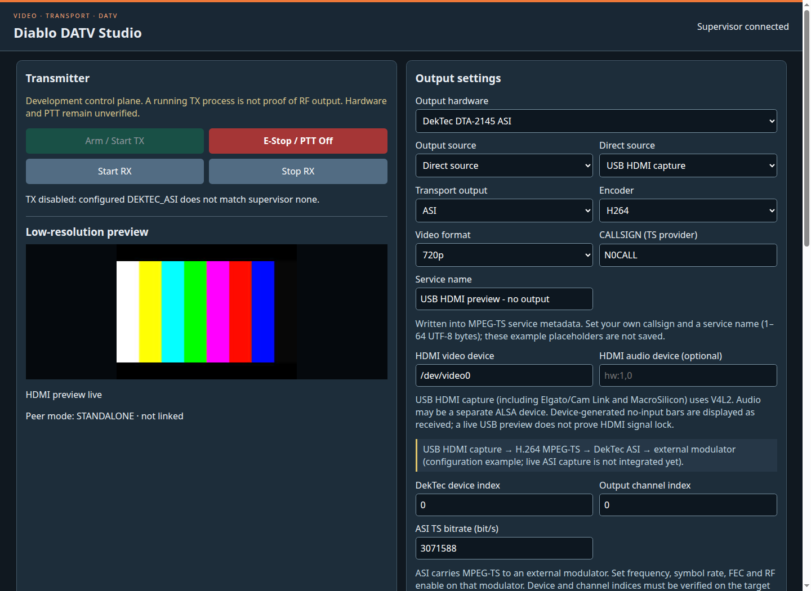

# USB HDMI capture sources

Select **USB HDMI capture** in Direct source (or an HDMI multiview tile). The
internal source key remains `HDMI`, so existing Elgato/Cam Link configurations
and presets remain compatible. This is a V4L2 source type, not an Elgato-only
backend.

## VideoLP3D: MacroSilicon MS2109, 2026-11-25

- USB identity: `534d:2109`, `MACROSILICON USB Video`.
- Video capture: `/dev/video0`; `/dev/video1` is the second UVC node and was not
  selected. The by-id link is `usb-MACROSILICON_USB_Video-video-index0`.
- FFmpeg enumerated **MJPEG and YUYV422**, sizes 640×480 through 1920×1080,
  plus intermediate 4:3/16:9 modes. A bounded 1280×720 MJPEG frame capture
  succeeded; FFmpeg reported 60 fps for that mode (not an endurance measurement).
- `PORTSDOWN_HDMI_INPUT_FORMAT=mjpeg` selects compressed USB capture for this
  installation. Preview is reduced to 320×240 at 5 fps with aspect-preserving
  padding. This setting is in `diablo.env`; the saved video device is in config.
- The real device was delivering vertical color bars. The actual web preview
  showed those frames, reported `HDMI preview live`, and hid the application
  placeholder. **No synthetic JPEG was injected.**
- Pausing only the owned FFmpeg capture process with SIGSTOP caused the live
  flag to clear and the MJPEG endpoint to return Diablo's `NO HDMI INPUT` card.
  SIGCONT restored the real device preview. This is a producer-stall test, not
  a physical USB unplug or HDMI cable-change test.
- The tests used supervisor board `none`, with TX/ASI launchers absent. All
  temporary capture/UI processes and SSH tunnels were stopped afterward.

The screenshot's ASI output settings were an isolated configuration example;
TX was disabled. It demonstrates real capture/preview, not HDMI-to-ASI output.
[Recorded state and loss/recovery checks](testing/usb-hdmi-2026-11-25/).

## Device-generated no-input picture versus missing USB frames

Some HDMI capture devices keep sending their own bars, logo or “no signal”
picture when HDMI input is absent. Diablo displays whatever real frames the
USB device supplies; it must not cover them with its own waiting card merely
because the picture is a test pattern.

If no fresh frames arrive, Diablo falls back to its waiting card. A live USB
preview is **not proof of an external HDMI signal lock**: device-generated bars
are also valid video frames. No image-based HDMI-lock detection or RF-validity
claim is made. Physical HDMI arrival/loss transitions still need testing.

## Audio and remaining checks

The device also enumerates as ALSA card `MS2109`, currently card 1/device 0.
However, the SSH account `mat` has video access but is not in the `audio` group;
its `arecord -l` reports no accessible cards. The preview is intentionally
video-only. Audio capture has **not** been validated and the saved audio field
remains blank.

An administrator can grant the intended service account group-based ALSA
access (for example `sudo usermod -aG audio mat`, followed by a new login), then
verify the actual capture formats and audio with a bounded recording. Device
indices can change after reconnect/reboot; recheck `/dev/v4l/by-id/` and
`/proc/asound/cards` rather than assuming all USB dongles use video0/card1.

Still required: known HDMI picture and audio input, physical arrival/loss
switching, A/V synchronization, sustained capture, and the full-quality
capture-to-selected-output lifecycle. Do not close D-03/D-04 on this preview
result alone.
